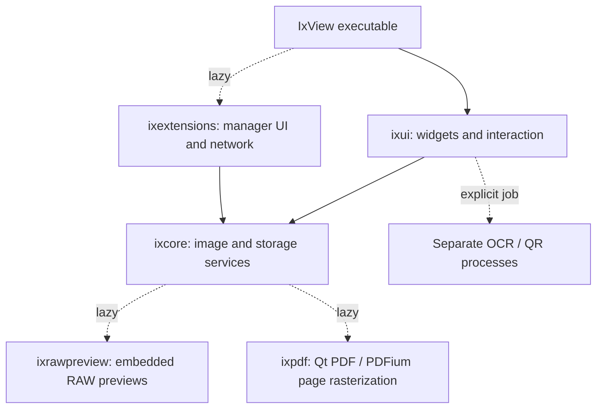

# Architecture

This describes the current implementation, including its remaining coupling. Update it when ownership, storage or an extension protocol changes. See [PLATFORMS.md](PLATFORMS.md) for builds and [DEVELOPMENT.md](DEVELOPMENT.md) for verification.

`appearance.cpp` owns the runtime brand icon alongside the effective interface
theme. Windows inherit the application icon instead of pinning an individual
copy. The two transparent SVGs are cached; only an effective light/dark change
replaces the application icon and updates an open About logo. Automatic mode
uses Qt's system color-scheme notifications. Fixed launcher assets use the grey
variant for contrast on both backgrounds. `scripts/build_icons.py` preserves
the supplied PNG alpha and generates SVG/ICO/ICNS at build time; Pillow is not a
runtime dependency. The original PNG variants are the canonical source assets.

## Targets and dependency direction

| Location | Owns | Boundary |
| --- | --- | --- |
| `src/main.cpp`, `ui/application.*` | Startup, storage initialization, OS file-open events | Initialize settings/storage before constructing consumers. |
| `src/core` / `ixcore` | Documents, codecs, processing, metadata, indexes, caches, storage and package integrity | Qt Core/Gui/Concurrent; no widget dependency or modal dialogs. Pure processing takes explicit inputs. Storage services resolve application paths. |
| `src/ui` / `ixui` | Commands, selection, dialogs, progress and presentation | GUI objects stay on the GUI thread; substantial file/image work goes to workers. |
| `src/modules/raw_preview.cpp` | Embedded RAW preview extraction | Loaded for RAW previews. Never develop a full RAW as a thumbnail fallback. |
| `src/modules/extension_manager.cpp` | Catalog/download/install UI | Optional module; Qt Network loads when the manager opens. |
| `src/tools` and installed `tools` | Standalone recognition engines and model data | Versioned protocols, process timeout, cancellation and output bounds. No resident engine in the viewer. |
| `scripts`, `.github/workflows` | Locked dependencies, validation, deployment and packaging | Source and runtime archives have separate inclusion rules. |

In-process modules are internal interfaces, built and deployed with the application and matching Qt/toolchain. They are not a stable public C++ ABI. When a signature changes, update its resolved symbol as appropriate and rebuild both sides; packaging validates matching binaries. Standalone extensions use the documented [tool protocols](TOOL_EXTENSIONS.md).

`ui/option_controls.h` contains lightweight widget presentation helpers for
Settings and fullscreen information: native checkbox semantics with full-row
hit targets, cached width-dependent label wrapping, and comfortable popup rows.
They own no preferences. Settings retains its existing save/cancel boundary and
keys; moving a field between pages must not migrate or reset its value. Geometry
rules are local to the dialog, so opening images creates no additional widgets
or resident services.

## Document ownership and operations

`ImageDocument` holds original pixel precision, metadata, source revision and page/animation state. `core/image_loading.*` owns the load pipeline (optional RAW preview, revision-aware cache read and presentation conversion) with an explicit `ImageLoadRequest`. `displayImage` prepares presentation pixels. `ImageView` owns fitting, scrolling, selection and its bounded optional display cache. Display caches must never supply pixels for save/export.

`QtCodec` takes metadata presence from a successful `readMetadata` result,
including a valid empty metadata set. Only when the reader supplies no result
does it scan the bounded 256 KiB header for conservative EXIF/IPTC/XMP export
warnings. Keep that fallback for unsupported formats and builds without Exiv2;
parser warnings are independent of whether an export-loss warning is required.

`CodecRegistry::openFilter` uses readable extension keys, with normalized groups
for aliases, instead of full decoder/encoder capabilities. Qt's extension source
reads plugin metadata without mapping codec libraries. Keep full capability
discovery for operations that need it, such as export formats and format details.
`ui/image_file_dialog.*` configures image-opening dialogs before `exec`: concise
filter labels, generic directory icons and a bounded initial widget size. Native
dialog availability remains controlled by Qt and the platform.

PDF pages are rasterized by the worker-owned `QPdfDocument` in `ixpdf`, at 144 DPI
with a white canvas and an operation-local pixel budget. Core/GUI targets do not
link Qt PDF. Thumbnail requests use a separate bounded-size export. The generic
Qt `qpdf` image handler is excluded from curated build/deployment plugins because
format enumeration otherwise eagerly loads PDFium. Build isolation copies plugins
without modifying the SDK; CTest overrides SDK plugin environment paths.

`ui/folder_traversal.h` owns an implicitly shared directory snapshot and a bounded
cursor. Failed folder loads advance within that snapshot, never rescan per failure
or cache a permanent rejection. The default policy indexes supported suffixes;
message/black policies index all regular files. Black entries have a path but no
image pixels: the view paints black, navigation remains active and pixel actions
are disabled. Explicit opens retain the previous document and show a named error.
Deferred explicit choices take priority over automatic skip continuations.

`MainWindow` currently coordinates the active document, commands, history and asynchronous completion. `DocumentActivity` is the single GUI-thread gate for loading/editing, saving, file transactions and delayed capture. Saving and file operations hold it across nested dialog event loops. Mutating commands must acquire the appropriate phase; queued opens/navigation run after the transaction finishes. `WorkMode` tells completion how to install a result and update history. Changing it while its worker runs is unsafe.

Discard confirmation has one policy for document replacement and closing:
the existing `navigation/askToSave` preference, defaulting to true when absent.
Only an explicit Discard or a successful Save authorizes replacement. Cancel,
dialog rejection and unsuccessful saves preserve the document and history.
Fixtures for the legacy discard mode set that preference explicitly.

Uncancellable save/trash/move/copy transactions use the progress overload in
`worker_wait.h`. It joins the future through the existing GUI event loop, showing
progress after 200 ms only if work remains. It does not enter QDialog::exec, so
completion during native show cannot close a dialog before its event loop starts.
The activity gate and input suppression remain active. Cancellable extraction
uses a separate path and is not covered by this overload.

The load service reads no settings and installs no document. Its optional preview callback runs only after a full-image cache miss, outside the cache lock, on the calling worker; GUI consumers queue it and check their generation/lifetime. Color management and display sharpening affect only the returned display image.

The cancellable `loadImage`/cache-read overloads return an empty optional for
cancellation, separate from reader errors. Checks surround pre-decode and
presentation stages; native reads/conversions already running are not preempted.
Completed unchanged originals may still enter the bounded cache. MainWindow
cancels an older full-load request only for a different newer explicit open over
an unmodified static current document with no RAW preview already shown. Edits,
save/file phases, page/animation state and relative-arrow queues retain their
existing ordering. RAW GUI callbacks also check the token. Cancelled completions
retain the visible document/history/selection. `deliverDeferredOpen` rechecks
busy/modal state, serves both polling and queued completion delivery, and never
changes the polling timer to interval zero. Destruction cancels queued load work
before joining. [State rules and measurements](SUPERSEDED_LOADS_2026-11-03.md).

`MainWindow::openPath` takes its path by value. Modal save questions process
events; directory snapshots or caller selections may change before loading
starts. Keep an owned, implicitly shared QString across that boundary, not a
reference into a widget or folder list. Navigation checks whether its target
actually differs before asking about edits. Page navigation revalidates its
target after saving, since export can collapse a document to one page. Explicit
reloads and animation use the load path without the navigation no-op guards.

Pixel history belongs to the GUI-thread value owner `core/document_history.*`.
MainWindow copies a target before preparing its display in a worker, then commits
the history transition only on success. History owns both stacks, selection,
source-state reconciliation and a combined 128 MiB/12-entry budget. It counts
shared QImage keys and Metadata pointers once. More distant states are evicted
first; one oversized nearest inverse remains available. Large edits can therefore
exceed this soft history budget. File operations have no disk history.

`core/image_memory.*` supplies the shared conservative estimates used by caches
and history, including image text/ICC, document properties and native metadata.
Small shared strings can still be overcounted; estimates are not process RAM.
The estimates saturate above the largest supported single-entry cache budget.
History sums component costs across its bounded entries without wrapping.

MainWindow consumes its single-result future with `takeResult()` before document
installation, so a finished future cannot retain an orphan original/display image
after Paste/New/Delete. PipelineDialog similarly consumes its completed result.
Never read these consumed results again. MainWindow disconnects completion and
joins its queued/running image work before members and children are destroyed.
Workers take values and only queue preview delivery; no worker waits on GUI work.
Joining does not make third-party decoders or blocking OS reads cancellable.

`platform_support` owns UI font selection. Startup applies `configureUiFont()` after selecting the UI language; legacy fixed-geometry dialogs use `referenceFont()` from the same policy. Korean/Japanese text has a minimum 9-point size and language-specific family preferences with system fallback. Font selection does not load downloadable assets or change image text rendering.

`core/localization.*` publishes an atomic language index into immutable embedded
catalogs. Non-German catalogs load once on the first non-German selection, and
remain available to concurrent worker readers; live switching never mutates a
map being read. The setter runs on the GUI thread. `uiLocale()` returns an
explicit value for widgets and presentation. `QLocale::setDefault()` runs only
at executable startup, before application workers: changing this non-reentrant
global during live work is unsafe according to the
[Qt locale contract](https://doc.qt.io/qt-6.8/qlocale.html#setDefault).
Directory collation therefore remains stable across an interface-language change.

`ui/interface_language.*` owns the application-lifetime Qt translator, UI font
refresh and LanguageChange notification. `bindUiText` retains source text and
optional formatting arguments on persistent UI objects; `retranslateUiText`
updates them without deleting actions, menus or widgets. Toolbar descriptions
regenerate native shortcut labels and accessible names too. ActionSearch observes
the existing QAction metadata, retaining its model rows and query. Dynamic crop
and recent menus use the active language when opened. Newly constructed dialogs
use active catalog text, and `dialogLayout` sets their explicit numeric locale.
If Qt retains a modeless About message, its title/version text is bound too.
Keep paths, user text, command IDs, shortcuts and settings keys outside translation.
Settings cancellation never publishes the pending language. A live change must
not reload pixels, clear history/selection, reset manual zoom or rescan a folder.

Workers receive captured value inputs and must not dereference widgets or implicitly use a later document. Results are installed on the GUI thread. Generation numbers reject obsolete RAW previews and thumbnail notifications; directory indexing uses pending-refresh state before installing a snapshot. Cancellation is cooperative: third-party decoders can continue until their reads return. Destruction must join active work or retain ownership until completion; a raw `this` capture is not cancellation.

`SlideshowController` owns sequencing; permission to advance remains with `MainWindow` and `DocumentActivity`. `FileOperations` owns direct file changes; pixel history remains in DocumentHistory.

`core/file_revision.*` owns native file identity and timestamp precision independently of preview caches. `CodecRegistry::save` captures or accepts an expected destination revision, validates it before encoding and again before `QSaveFile::commit`. The UI retains that revision across its output warnings. Empty expected revisions require absence; omitted expectations capture the current target. These checks narrow external-write races but are not an atomic filesystem compare-and-swap.

On successful full-image save, the document and its Undo history share the
destination's written metadata-presence flag, derived from native containers,
EXIF/IPTC/XMP flags and the chosen format. A valid empty metadata object does
not imply tags were written. Selection export does not replace the active
source state. The Save-as regression checks this against a fresh target decode
and compares the complete export-loss report before/after Undo.

Batch runs check source revisions before/after reading and before atomic commit. An optional configured codec registry is copied into workers; custom readers must support the chosen parallelism. The synchronous run joins workers before returning, so the supplied registry is never retained afterward.

BatchPipeline progress callbacks execute on workers and can arrive concurrently
or out of count order. They must be thread-safe/nonthrowing and must not wait
for GUI processing. PipelineDialog publishes through its atomic progress mailbox
and queues guarded, generation-checked values. Returning from run joins callbacks
but does not drain queued GUI deliveries; QObject receiver lifetime still owns
those events. A regression exercises that distinction with four real exports.

`core/batch_plan.cpp` owns read-only destination planning separately from image
transformation and execution in `batch_pipeline.cpp`. `plan(job, cancel)` returns
a complete review or an empty list on cancellation; a partial plan must never be
offered for execution. It checks cancellation while enumerating and inside
destination/resource hashing. File identity, input/output collisions and overwrite
policy are resolved before hashing a destination; only eligible regular-file
replacements receive a content hash. Repeated watermark paths share one hash.
Existing target revisions are rechecked after hashing. Execution still verifies
reviewed revisions/content before atomic output; skipping an ineligible
target's hash must not weaken those commit guards.

`core/batch_memory.*` admits pipeline jobs before full decoding. A process-local
weighted FIFO gate shares the immutable image-memory budget across simultaneous
pipeline runs, independently of their requested worker count (still at most four
per run). Header dimensions/format, both axis orientations and all chain steps
estimate a job's peak live work; shared watermark pixels are conservatively charged
to every job. Unknown headers/configured codecs and estimates above the budget
take the whole capacity and run alone. Oversized jobs retain their existing
disk-backed path and per-operation guards; admission does not reject them merely
because their estimate exceeds RAM.

The move-only lease spans decoding through export and is released after image
buffers on success, cancellation or exceptions. Waiting workers hold no decoded
source, poll cancellation every 20 ms and recheck source identity after admission.
Never acquire a second lease while holding one. Retained original/presentation/
preview cache cost reduces admission headroom; later cache growth does not
preempt active jobs. This coordinates estimated work, not RSS: history,
active-document buffers, watermark resource loading, decoder-internal
allocations, plugin header probes and mapped-page residency remain outside the gate.
There is no GUI wait or new startup worker. See [batch memory review](BATCH_MEMORY_2026-11-02.md).

PipelineDialog clears previous results when inputs/options change and captures a
new job only when Start is pressed. A new run resets cancellation after previous
work has finished. Planning and execution share one worker lifecycle; no separate
preview is required. Preview/run APIs reject pre-cancelled requests before
resource/decode work. Cancellation does not interrupt a blocking OS read or a
third-party decoder. Worker exceptions are contained at the GUI completion
boundary and shown as errors, never as successful empty runs.

## Caches and expensive work

Library dialogs own an immutable input-list copy. Initial catalog snapshots load
asynchronously and publish only into the live dialog; read tasks capture the
catalog path by value and can finish safely after a closed dialog disconnects.
Annotations run value-captured storage work; the index worker returns its updated
snapshot. Neither path reparses catalog JSON on the GUI thread. Controls wait for
the first snapshot and reject reentrant catalog jobs. Preview work stays limited
to visible rows. The old eager whole-folder thumbnail dialog has no callers and
has been removed.

`ui/worker_wait.h` joins GUI-owned work through an event loop that keeps paints,
timers and user input alive. Reentrancy is covered by DocumentActivity (commands
return early while a transaction runs), by the caller's modal progress window and
by closing checks, so stack captures stay valid without suppressing input. The
progress window appears only after 200 ms; joins over two seconds are logged.
Saving is cancellable: the dialog's cancel signal sets a flag that
`CodecRegistry::save` reads through `beforeCommit`, so the staged `QSaveFile` is
discarded before any commit and the document keeps its edits and modified state.
An encoder already running is not interrupted; its result is dropped when the
join ends.
Non-cancellable rename/copy/trash jobs keep a modal window without a cancel
button; it reappears if dismissed while the join continues, so a blocked window
always carries a visible sign of the running work. Shutdown can end that loop
early, so a final blocking join still protects stack captures. Never detach such
workers to hide a cancellation wait.
Search/extraction hold DocumentActivity's file phase across chooser/worker
processing; folder discovery runs with owned worker values.
The extension manager filters cached row text in-place during typing and reloads
stores only on actual refresh/state changes. Real tool operations continue to
read fresh storage state; this does not weaken package/lease validation.

`DirectorySnapshot` carries a shared ordered list and positional lookup. Use const access during navigation to avoid detaching large Qt containers. `DirectoryIndexService` owns one low-priority worker, its cancellation token and at most one pending request. A newer request cancels the active scan and replaces the pending value; cancelled results never reach consumers. Destruction cancels and joins work. Scanners receive values and a token, with no widget/service access; a supplied scanner must observe cancellation and support destruction-time joining. Result consumers may request another scan or destroy the service synchronously. MainWindow retains folder watching, the installed snapshot and navigation decisions.

Directory scans use one per-scan suffix set for literal ASCII format keys,
avoiding a complete wildcard-list match for every filename. Empty/compound/
wildcard/Unicode filter forms retain Qt's original iterator filtering. Unicode
filename suffixes use Qt matching too: lowercase alone does not preserve its
case rules (for example long s). Keep cancellation checks before filtering and
attribute reads after acceptance. The [filter review](DIRECTORY_FILTER_REVIEW_2026-10-31.md)
records Qt-reference tests and complete-scan component measurements.

The optional `ActionSearch` owns a persistent row per command and observes that action’s metadata/lifetime. Typing changes the completion prefix, without rebuilding rows. Empty queries cannot invoke a retained match. A completion consumer may delete the selected action/widget; invocation retains a guarded action and schedules its context timer before notifying consumers.

`PreviewService` separately owns two low-priority workers and a queue that drops obsolete requests before creating futures. On a thumbnail-cache miss, an unchanged, single-page, nonanimated PNG/BMP original at the same source revision can supply pixels through QImage implicit sharing. Borrow under the cache lock, then scale outside it; never use an edited/display image or apply this shortcut indiscriminately to decoder-scaled JPEGs, RAW or animation pages. Cancellation/null checks and a native revision recheck follow scaling too. Do not replace revision checks with timestamp-only assumptions.

Original documents, prepared color/sharpen presentations and eligible full
PNG/BMP pixels retained during thumbnail decoding share the configured
image-cache allowance. Optional pixels may use only spare capacity; incoming
originals reclaim them before their own LRU eviction. Thumbnails keep their own
requested ceiling but all four kinds share a combined ceiling no greater than
the image-memory budget. Viewport and animation caches remain separate. These
limits are not a total RAM limit: active decoders, edits, encoders and undo also
consume memory. Measure first decode, cached decode, indexing and repaint
separately. [PERFORMANCE.md](PERFORMANCE.md) records comparisons and their limits.

`ImageLoadCache::prepareDisplay` identifies one reusable presentation by the
original's revision/page and QImage identity plus color-management/sharpen flags.
It computes outside the cache mutex and rechecks identity/epoch before insertion.
Alias presentations retain no second pixel entry. Clear, targeted invalidation
and configuration changes prevent older workers from repopulating caches;
unchanged requested budgets preserve already-cached presentations. A lock-free
retained-cost snapshot feeds batch admission without a cache/gate lock inversion.
Cache growth does not preempt active jobs; a sole oversized job retains its
existing guarded/mapped path. See [the cache and navigation review](EVERYDAY_PERFORMANCE_2026-11-02.md).

`takePreviewPixels` consumes revision/size/format-matched full pixels from a
completed static unrotated PNG/BMP thumbnail decode. It supplies no document or
metadata; foreground header checks, policy and metadata extraction remain in
the codec. This path excludes animations, decoder-scaled formats and buffers
outside 1–96 MiB. Nearest next/previous neighbors are submitted first and take
retention priority over farther entries. Epoch and revision checks apply to
both insertion and handoff. See [scope and measurements](PREVIEW_HANDOFF_2026-11-03.md).

Simultaneous eligible native PNG/BMP full-pixel reads also share an active
decode, keyed by revision, size, pixel format, codec and cache epoch. Each caller
retains its reader/header/metadata workflow. An active record exists only until
its owner completes; it is not another persistent cache. Condition waits release
the cache mutex, preview waits remain cancellable, exceptions wake waiters and
same-thread reentrancy bypasses waiting. Failed/rewritten results retry through
the caller's reader. Old generations cannot remove newer entries. Foreground
joins temporarily raise low-priority Qt owners, restoring their priority on exit.
Activity counts cover coordinated owners/waiters only. [Evidence and limits](CONCURRENT_DECODE_2026-11-03.md).

Document/thumbnail insertion costs include comments, text, ICC bytes and native
metadata estimates in addition to pixels. `Metadata::nativeBytes` is collected
with tags, including available EXIF data areas; it is a bounded estimate, not
serialized profile state. Charges can overcount shared buffers. The 96 MiB
original-pixel cache-admission ceiling still applies; it is not an image loading
or editing limit. The [external review](EXTERNAL_REVIEW_2026-10-31.md) records a
100 MiB load/crop/Undo proof. Total entry cost uses the selected
budget. Disabled caches skip cost preparation. Cost arithmetic rejects entries
beyond the maximum supported budget rather than wrapping/saturating into it.

Cache operations capture an epoch under their shared mutex before releasing it for
decode work. Clearing advances that epoch, so an older completion cannot
repopulate a cleared cache or overwrite a newer entry. Already-running calls
can still return to their original consumers; this does not replace UI request
generations, cancellation tokens or source revision checks.

Resize image-buffer estimates distinguish native nearest-neighbor copying from 16-bit separable filtering and account for overlapping conversions/sharpening. Weight tables, allocator overhead and concurrent operations are additional costs. Derived DPI respects the UI range; processing rejects invalid density conversions before allocation.

`convolve` recognizes only the exact standard 3×3 sharpening kernel (center 5,
four neighbors −1, zero corners), divisor 1 and offset 0. It computes those
bounded integer channel values in native RGB32/ARGB32 when possible, otherwise
in the existing RGBA64 working format. The byte path avoids both RGBA64 buffers
and format round trips. SSE2 handles four interior pixels using signed-word
arithmetic and saturating packing; original alpha is restored and RGB32 is opaque.
Row borders and non-SSE2 targets use the same scalar byte calculation. No shared
scratch state, new pool or dependency is involved. The current conservative
memory-admission checks remain unchanged.
Edge replication, unchanged center alpha, output conversion and inherited
profile/text/DPI match the scalar path. Other kernels/divisors/offsets retain
that path. `tests/convolution_reference.h` keeps the original scalar arithmetic
for independent comparisons; extend precision/edge coverage when changing this
specialization. No additional image buffer, cache, thread pool or dependency is
introduced. The shared operation serves explicit sharpening, resize sharpening,
default-amount batch sharpening and optional display sharpening.
See [native-path proof and measurements](NATIVE_SHARPEN_2026-11-03.md).

## First-image presentation

Pixel transforms check source pixels plus overlapping working/output-conversion
buffers against the configured image-memory budget before allocating. Convolution
releases its input before final conversion; auto levels releases its histogram
input before pixel output. RGBA64 source sharing is accounted once. This is an
operation-local image-buffer estimate, not a global RAM cap; histogram tables,
metadata, other documents/workers and allocator overhead remain additional.

Negative/channel/swap operations use `perPixel32` only for straight RGB32/ARGB32.
Byte-exact masks/extraction replace whole-image RGBA64 conversion; the combined
source/output pixels need 8 rather than 16 bytes per pixel. Alpha, color space,
DPI, text, device-pixel ratio and image offset retain their previous semantics.
Premultiplied, indexed, HDR and higher-depth inputs retain the RGBA64 path.
Grayscale/color-adjust arithmetic is unchanged: a generic per-pixel 32/64-bit
adapter reduced buffers but slowed grayscale in the measured prototype.

Automatic border cropping reads native straight RGB32/ARGB32/RGBX64/RGBA64
scanlines without another image allocation. Tolerance retains QColor's 8-bit
channel semantics. Premultiplied, palette and floating-point formats keep Qt's
pixelColor path to preserve conversion/rounding behavior. Independent scalar
comparisons and the opt-in `--profile-auto-crop` mode cover this boundary.

`ImageDocument::sourceModified` is the last-write time observed on a successful
read, retained with that loaded revision through cache/edit history. Status
refreshes format this value without polling the filesystem. Reopening/reloading
refreshes it. Save/rename workers return revision, timestamp and size together;
install these in both the active document and applicable history. Selection
exports and copies keep the active source unchanged. See the
[source-state review](REVIEW_2026-10-26.md) for tests and concurrency limits.

The first image must not wait for folder-format discovery on the GUI thread.
MainWindow requests `discoverImageFormats` for its directory jobs; the default
scanner resolves registry/plugin metadata on its worker. Explicit extension
filters retain their existing semantics (an empty explicit filter lists all
files). Discovery reuses the registry's thread-safe static key cache and does
not instantiate every decoder. Folder results still obey cancellation and
generation ownership. Recent-file and directory settings share one write scope
when installing an image; unchanged values are not rewritten.

Command availability must not fetch external clipboard payloads. On native
Windows, `ui/platform_support.*::clipboardHasImageOrUrls()` checks advertised
Win32 formats without opening the clipboard or querying an OLE data provider.
Actual Paste still retrieves through Qt and applies normal document guards.
Other backends use one Qt MIME availability pointer. The UI suite checks
payload-free availability, later clipboard changes and real image paste; its
native Windows branch also verifies a concurrently held clipboard lock.

`IX_PROFILE_IMAGE_LOAD=1` adds optional `ix-startup` checkpoints in `main.cpp`
before/after initialization and window setup, alongside existing codec/worker/
document-install timings. DLL loading before entry to `main()` is outside that
clock. See [startup diagnosis and limits](STARTUP_CLIPBOARD_2026-11-03.md).

## Recognition ownership

`ToolStore` validates packages and acquires per-job leases that pin engines/models against removal. `ToolDialog` owns the temporary directory, cancellation token, process, timeout, bounded output and result controls. `prepareRecognitionInput` in `core/recognition_input.*` owns selection export and model staging without UI/settings access. It returns an error string and leaves partial files for the directory owner to remove. Its PPM export deliberately flattens transparency to white and produces 8-bit input for the existing text protocols; original pixels are unchanged.

An image-producing tool needs a documented result contract plus document-install/Undo handling. Adding an executable or catalog row alone does not add a capability. See [TOOL_EXTENSIONS.md](TOOL_EXTENSIONS.md) and [EXTENSION_IDEAS.md](EXTENSION_IDEAS.md).

## Storage and compatibility

`AppStorage` resolves profile/cache locations and portable migration. `ExtensionStorage::Domain::Formats` and `Domain::Tools` have separate requested/active roots and restart boundaries. Check the domain used by the operation. Preserve legacy identifiers such as `IxView-data`, settings keys and `org.ixview.IxView`; the product rename is not a storage migration.

Use existing transactional helpers, locks and path validation. Never replace corrupt state with an empty file silently. Never recursively copy a profile into its descendants. Deployment preserves personal state; Windows releases use a separate verified factory tool snapshot. Native archives currently exclude local tool stores. See [PORTABLE.md](PORTABLE.md) and [RELEASING.md](RELEASING.md).

## Platform presentation

Appearance synchronizes existing framed Windows widgets through
`applyNativeWindowTheme`. DWM attribute 20 falls back to 19 for older Windows 10,
as in Qt 6.8. Theme, show and handle-change events queue one guarded reapplication
after Qt's platform handler; widget/application lifetimes own delivery. The
helper never creates a native handle or changes geometry/window flags. Image
loads, title text updates and normal paints do not invoke this frame path.
Other platforms retain their normal window-manager decoration.

Windows fullscreen presentation and global hotkeys belong in `ui/platform_support.*`. The Windows transition cover uses an opaque native layered surface: upload the complete snapshot before showing it, fence presentation before native resizing, and retain it through final painting/presentation. A newly shown QWidget may not have painted yet, so DwmFlush alone does not establish content readiness. The cover owns its HWND, releases temporary bitmap/DC resources immediately after upload, and is destroyed on completion, replacement or owner destruction. It has no Qt backing store and receives no focus or mouse input. Arbitrary sleeps or removing compositor fences can conceal a race in one run and reintroduce flicker elsewhere. Changes require native DPI/window tests; offscreen tests cannot prove visual behavior on every GPU.

## Next refactor boundaries

`MainWindow` remains too broad. Extract loading/navigation coordination, save transactions and file-management presentation incrementally, retaining the state/Undo/native-window regressions. Moving methods into another `.cpp` alone does not separate ownership. Put new pure transformations and worker preparation outside dialogs; introduce generic interfaces when another implementation actually needs them.

Prioritize the remaining boundaries in this order:

| Boundary | Responsibility to move | Contract to retain |
| --- | --- | --- |
| Loading/navigation controller | Worker, request generation, deferred opens and queued steps | Latest explicit choice wins; file/save phases remain exclusive; stale previews cannot install. |
| Save transaction | Immutable source snapshot, destination revision and nested-dialog lifetime | External target changes survive; failure retains edits; selection export keeps the active document. |
| Catalog storage | Large snapshot/search/index persistence | Ratings and marks survive concurrent index updates; backups/migration and corruption rejection precede a format change. |

Take one ownership boundary per change, define its value inputs/results first,
then exercise the existing workflows before removing the original path. Keep
performance evidence for first decode, cached navigation and large-folder work
separate. A new dependency or storage format needs a demonstrated benefit and
compatibility/migration coverage.

Open risks include native Windows 10/Linux/macOS coverage, total-memory coordination, uncommon RAW/color variants and very large catalogs. [The latest review](REVIEW_2026-10-28.md) records the current scope and remaining boundaries; this document does not claim they are solved.

The [architecture/resource audit](ARCHITECTURE_REVIEW_2026-10-28.md) records the
history extraction, result lifetime measurements and remaining coordination work.
Lossless JPEG transformation now accepts source/destination revisions spanning
chooser/worker scheduling, and checks them before transformation and publication.
Page extraction passes an explicit empty target revision, requiring absence even
if another process creates a file after its initial existence check. These checks
narrow races; QSaveFile publication is still not a filesystem compare-and-swap.

### Direct batch execution and reporting

`PipelineDialog` captures the filtered input list and current validated profile
when Start is pressed. Its worker calls `plan` then `run`; the plan table is a
queued observational update, not an approval gate. Editing is disabled until
completion; cancellation also covers planning. No preview decoder runs in this
path. Keep the lower-level preview API for non-dialog consumers and its codec
quality tests. New dialogs do not install default processing steps.

`PipelineFile::inputBytes/outputBytes` record actual source and staged output sizes;
output bytes are set only after atomic save succeeds. `core/batch_report.*`
aggregates successful entries and writes an optional uniquely named UTF-8 CSV
without replacing existing files. Text fields are quoted and spreadsheet formula
prefixes escaped. Logging failure is separate from conversion success. Statistics
measure image bytes rather than auxiliary report overhead. A decoder/encoder is
never run just to guess savings. Monitor selection and fullscreen sizing reuse
Qt screen APIs and the existing ImageView modes; default monitor selection does
not relocate the native window or alter the presentation-cover path.

### Batch UI and throughput review — 28 October 2026

`pipeline_step_editor.*` owns step labels and modal parameter editing.
`PipelineResultModel` owns a shared immutable result-list snapshot; `QTableView`
asks for cell/tooltip strings only as needed. Do not recreate four persistent
cell objects per input or walk every result merely to display the table.
`PipelineDialog::profile()` reads only the small chain; routine validation must
not construct a full job/input snapshot. Capture inputs only when starting work.
File additions use a set for exact-path deduplication, matching earlier semantics.

The execution result includes optional report path/error. Logging stays on the
worker, with approximately 64 KiB CSV chunks plus the current row and partial-file cleanup. Return conversion
results even when logging fails. The core skips watermark resources and threads
when no entries are eligible, limits threads to useful work, and catches unknown
C++ exceptions inside each file operation. Existing source revision, target hash,
resource hash and atomic save guards remain in force.

The batch Processing page uses a single vertical order (inputs, shallow chain,
output/options) instead of side-by-side large lists. Results and their status/
progress occupy another page, so running/reporting does not raise the minimum
configuration-window height. Configuration feedback has a separate label.

### Fit policy versus retained numeric zoom

`ImageView::fit()` describes the active policy; `browsingFit()` survives a manual
zoom so navigation/fullscreen exit can return to the selected browsing policy.
During `MainWindow::installDocument`, retain a numeric zoom only when the active
fit is Original and either zoom locking or an in-place document update requests
it. An active Window/LargeOnly/axis fit is recalculated for each new image. Never
convert an automatic fit to Original merely because lockZoom is set: the old
factor can leave scroll ranges on a wider/taller successor and consume folder
navigation keys/wheel input. A saved lock must not force 100% on initial opening.
Fullscreen's own fit policy retains precedence on ordinary image changes.

Window fitting is persisted by explicit fit commands and accepted Settings, never
by closing a window. Close-time persistence would let an older window overwrite
a newer global preference. `applySettings(true)` updates `windowBrowsingFit_`
during fullscreen and the actual view in windowed mode. Settings acceptance also
compares the requested fit with that window's browsing policy, so confirming an
unchanged global value updates a stale window without cancelling a deliberate
manual zoom when the browsing policy already agrees. Fullscreen's own display
policy remains separate from the window policy applied on exit.

### Display-fit menu selection

`ui/view_fit_options.h` is the shared command/fit/one-shot window-resize mapping.
The window display submenu owns one exclusive QActionGroup. `view/fit` remains
the authoritative browsing policy; optional `view/fitCommand` retains the exact
window/screen variant for an unambiguous checkmark after restart. Reject a hint
which disagrees with the actual policy and use a canonical entry for old profiles.
Do not infer an active screen variant merely from the current window size.

Menu opening synchronizes from the actual view (manual zoom selects noFit), or
from `windowBrowsingFit_` while fullscreen. Explicit commands/accepted settings
and fullscreen transitions also synchronize; no menu work is added to per-frame
zoom/paint callbacks. A blocked exclusive action restores the checked action from
actual state, rather than simply inverting the newly checked item's boolean.
Window-fit commands invoked while fullscreen update its return policy as well as
the immediate view; the separate fullscreen preference remains unchanged.

The once-installed Fusion proxy in `appearance.cpp` paints exclusive menu items
with the same checkmark control as independent menu toggles. QActionGroup still
owns exclusivity and accessibility semantics; only CE_MenuItem painting changes.
The base style owns palette/DPI geometry. Theme changes update palettes rather
than recreate the style. Pixel comparisons exercise both kinds in light/dark,
selected/unselected and enabled/disabled states; image rendering is unchanged.

## ZIP/CBZ image archives

`src/modules/archive_image.cpp` implements a read-only QImageIOPlugin using
KArchive. Its metadata exposes ZIP/CBZ to the existing format registry, file
filters, preview reader, page controls and format manager. No archive code or
KArchive import is linked into the viewer executable. Build when KF6Archive is
available; omit cleanly otherwise. CMake installs the plugin beside the app on
Windows/Linux and under bundle PlugIns on macOS; native dependency deployment
also scans this module. The portable deployment and source/byte audit include it.

Each handler owns a bounded ZIP directory, naturally sorted page list and one
embedded decoder. No extraction or global archive cache; inner animations and
multi-page files contribute their first image. A non-owning device adapter keeps
Qt's input open when KArchive closes or rejects a container. Header validation
bounds directory allocations before KZip parses; entry data and decoded geometry
have separate limits. Hidden/Apple metadata entries and nested archives are
excluded. See FORMAT_COMPATIBILITY.md for the supported ZIP subset. PDF, RAR/CBR
and JPEG XR require separate backends and are not advertised by this plugin.

### File operations without a journal

`core/file_operations.*` performs direct copy/move and native system-trash
operations. It creates no operation records, backup repository or disk-Undo
history. Its result carries applied state and copy/move revision snapshots;
catalog-relocation warnings do not imply that the file move failed. A
separate `warning` field carries them; `error` describes an incomplete requested
operation. Classic batch preserves that distinction in its results and log. A
process-local mutex serializes these operations. No image payload hashing is
needed for a normal rename. Source revisions are rechecked after worker-side
preflight, including native trash. The confirmation's source revision can be
carried into the worker; an observed replacement then prevents the operation.
Native trash failures never fall back to permanent deletion. Restoration uses
the operating system. Pixel Undo/Redo remains owned by DocumentHistory.

POSIX moves use native no-replace rename (Linux renameat2, macOS renameatx_np)
or link/unlink; they never fall back to overwriting raw rename. Cross-volume
copies stage in a private target-volume directory and publish with that same
primitive before removing the unchanged source. Filesystems without either
safe primitive fail closed. Source-removal failures can leave both names and
return an error; do not delete a possibly replaced target to conceal that state.
Windows retains QFile's native behavior. These checks are not a cross-process
source-revision compare-and-swap. Native Linux/macOS validation remains required.

Classic batch uses the transient `BatchFileChanges` summary. Two hash maps track
original file identity and current path, so reusing a freed path does not join
unrelated files into a rename chain. Each applied entry updates this summary in
constant expected time. MainWindow follows the original's final path once;
FileOperations relocates direct-move annotations immediately. Classic rename
batches use a worker-owned `CatalogBatch`: a recursive process-local operation
lock spans physical moves and one ordered catalog flush, including cancellation.
The catalog is read under its own lock at flush time, retaining latest unrelated
annotations. A temporary ordered tree avoids quadratic sorted-JSON edits; output
is written once. An explicit commit reports errors, with best-effort destructor
flush on exceptional exits. This is not a crash-safe transaction spanning image
files and catalog; a crash before flush can leave annotations at old paths.
Files without an annotation do not trigger a catalog rewrite. The summary lives through the dialog and its
immediate owner reconciliation; no mapping is persisted to disk or another run.
Initial-source and final-target revisions prove when only the path changed;
that case updates document/history source metadata without redecoding or clearing
pixel Undo/Redo. A source rewrite between moves invalidates the proof.
The dialog holds DocumentActivity's file phase, stops slideshows and defers
external opens. Affected paths invalidate caches after conversion/rename; unchanged
neighbors survive cancellation and completion. Revision checks reconcile actual
changes; uncommitted edits remain protected.

Batch exports write directly through CodecRegistry::save and QSaveFile. The
reviewed target revision and content hash are checked, while a beforeCommit
callback rejects cancellation or a changed input after encoding. Encoder,
metadata, guard or commit failure discards the staged output. Successful
replacements have no later file-Undo or persistent backup. Reject directories
and symbolic links as export targets. This provides atomic output replacement,
not a transaction excluding non-cooperating external writers.

### Selective cache invalidation

Direct file operations invalidate affected paths through ImageLoadCache.
Keys retain lexical absolute paths separately from opaque revision/page/bounds
suffixes; delimiter characters in Unix filenames stay unambiguous. Eviction
iterates keys without changing unrelated LRU order and charges key storage.
One bounded epoch rejects older in-flight insertions while retaining cached
neighbors. Unrelated APNG sessions also survive. Conservative global clears
remain for global preferences and some external-source/batch reconciliation.

## Large-image RAM contract

`core/memory_policy.*` initializes an immutable process budget before decoding.
It probes physical RAM per OS, supports a manual MiB setting, bounds 32-bit
addressing and sets Qt's non-atomic reader limit once. Settings changes require
restart. Decoder and operation guards use this budget. Cache/history costs use
an independent signed-int saturation bound. PDF receives its budget explicitly.
8-bit resize retains RGBA64 intermediate precision per horizontal row and uses a
bounded row cache; the final image is native 32-bit. GUI estimates and worker
preflight share the same calculation. Display caches remain unsuitable for
Save/Export. Details and phase status: [large images](LARGE_IMAGES.md).

`core/image_storage.*` owns mutable QImage file mappings, physical disk
reservation, aggregate backing accounting, last-reference cleanup and locked
stale-buffer cleanup. The pixel allocator is shared by row resampling, direct
PNG/sequential-JPEG reading, crop copying, native 32-bit effects and row-based
ICC/alpha conversion. Files contain a versioned geometry header and never point
at user source files. A process lock protects each live buffer and a root lock
serializes file creation against stale cleanup. Thread-neutral QFile objects
can be released by the last image owner on either worker or GUI thread.
Backing files of 16 MiB or more released on the GUI thread are removed by a
single low-priority deleter thread instead of blocking the window; tests and
shutdown can flush pending removals with `flushImageStorageDeletes()`, and
files left behind by a crash or shutdown race are reclaimed by the next
startup scan.

The resize dialog and worker share resizeFitsBudget; logical mapped source and
destination bytes are separated from estimated resident work. Non-streaming
operations retain RAM guards. Large PNG/JPEG writes bypass full encoded metadata
buffers, explicitly expose metadata loss, and keep QSaveFile/revision contracts.
No preview or display raster may replace document.pixels. See LARGE_IMAGES.md
for codec limits, settings, disk reservation and the non-global RAM guarantee.

Selection export prepares original-pixel crops in its worker before loss
confirmation. `image_export_policy.h` shares the streaming threshold between
encoder, confirmation and post-save source metadata state, so a successful
streamed write cannot be recorded as having rewritten EXIF/IPTC/XMP.

## Resampling workers

`core/resampling.cpp` owns filter kernels, row caching, resize limits and
resampling; `processing.h` retains the public API. The normalized-row path
premultiplies/converts a source row for each horizontal cache entry and preserves
the RGBA64 horizontal rounding boundary before caching double samples. Vertical support reuses those
samples. Byte quantization retains the two-stage thresholds, tie cases and the
legacy long-overflow behavior for near-zero-alpha ringing.

The x86 8-bit output path uses baseline SSE2 to clamp, quantize and pack a pixel.
Near byte ties or the legacy long-overflow boundary it calls the scalar
quantizer. Other architectures retain that scalar path. No AVX requirement or
fast-math flag is introduced. Gamma input normalization lazily evaluates all
65,536 possible RGBA64 input values using the original transfer function, then
shares the read-only 512 KiB table. Its size is included in gamma resize estimates;
neither viewer startup nor ordinary non-gamma resizes allocate it.

For normalized 8-bit gamma output, `core/resize_transfer.h` maps linear channels
to quantized sRGB bytes through inverse byte boundaries. A 4096-entry guess table
locates the neighboring boundaries; it never interpolates output values. Within
1e-10 of a boundary, the original forward transfer and RGBA64-to-byte rounding
decide the result. The immutable transfer object is initialized on first use and
its approximately 6 KiB are included in gamma estimates. Sixteen-bit output and
the compact-row fallback retain the continuous transfer. Boundary-adjacent,
whole-range and independent full-image reference tests guard this specialization.

Large outputs may use four disjoint row bands. A process-local atomic pool caps
additional resize threads across concurrent caller jobs; the calling worker
participates. std::thread plus a scope guard joins all children on every exit,
including creation failure. Exceptions stop peers and propagate after joining;
shared cancellation never publishes partial output. QImage's unique writable
buffer is obtained before launching threads; workers write raw, non-overlapping
rows and never call mutable QImage accessors concurrently.

Nearest-neighbor shares this worker reservation and join/exception handling.
RAM-backed byte-addressable outputs of at least 8 MiB use adjacent blocks of 256 rows,
reusing repeated source rows only inside the worker's own block. The source
column map is shared read-only; workers need no additional pixel buffers.
Packed monochrome stays serial because it uses QImage's mutable pixel API.
Mapped nearest output also stays serial: proportional 100k probes showed more
page pressure, CPU time and elapsed time with concurrent bulk-copy writers.
A pre-cancelled nearest request throws before allocating its output, retaining
the existing nearest cancellation contract.

The row-cache cap is divided across actual workers. Planning includes the
maximum worker-local source, accumulation and active-row storage. If normalized
full-width rows would reduce useful parallelism, workers use column tiles of at
most 8192 pixels in blocks of 256 output rows. Weights still use global output
coordinates, and changing the column tile clears the source-row-keyed cache.
Wide jobs take neighboring row blocks from a shared atomic cursor rather than
writing several far-apart multi-GB bands simultaneously. Short outputs use
smaller blocks to retain parallelism. The full-width path executes its band once.
The planned tile width remains fixed if fewer thread slots are available, so
worker-local allocations cannot grow beyond the estimate. Full-width rows remain
the fast path when their support fits. If even tiled rows cannot retain
overlapping support in the bounded cache, the existing
compact RGBA64-row path remains available. File-backed destinations use the same
worker lifetime contract. No nested global QThreadPool waits, new runtime
libraries, startup workers or GUI controls are introduced.
