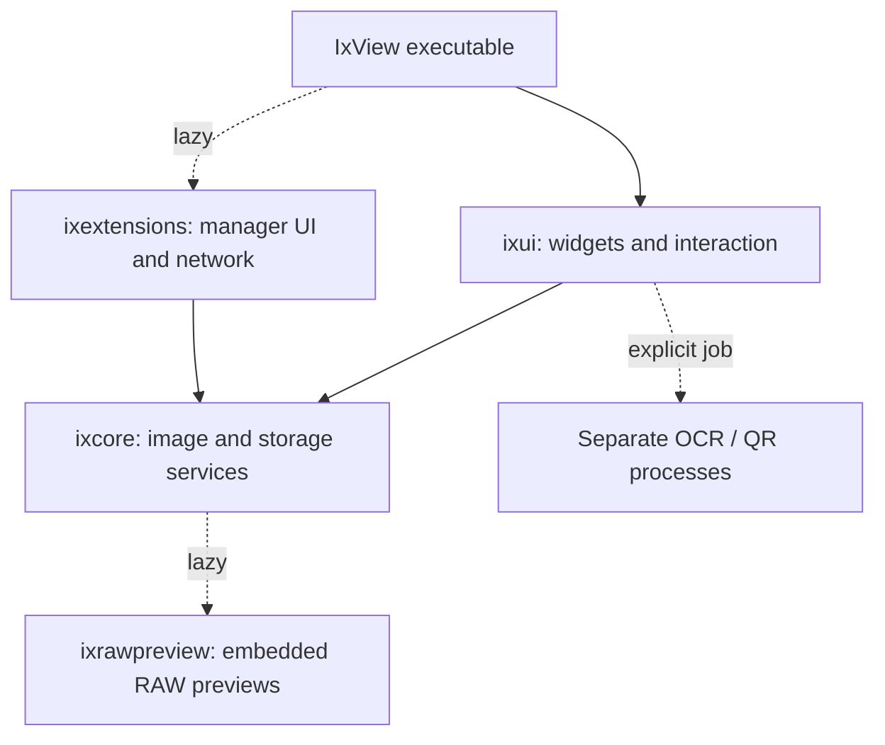

# Architecture

This describes the current implementation, including its remaining coupling. Update it when ownership, storage or an extension protocol changes. See [PLATFORMS.md](PLATFORMS.md) for builds and [DEVELOPMENT.md](DEVELOPMENT.md) for verification.

## Targets and dependency direction

| Location | Owns | Boundary |
| --- | --- | --- |
| `src/main.cpp`, `ui/application.*` | Startup, storage initialization, OS file-open events | Initialize settings/storage before constructing consumers. |
| `src/core` / `ixcore` | Documents, codecs, processing, metadata, indexes, caches, storage and package integrity | Qt Core/Gui/Concurrent; no widget dependency or modal dialogs. Pure processing takes explicit inputs. Storage services resolve application paths. |
| `src/ui` / `ixui` | Commands, selection, dialogs, progress and presentation | GUI objects stay on the GUI thread; substantial file/image work goes to workers. |
| `src/modules/raw_preview.cpp` | Embedded RAW preview extraction | Loaded for RAW previews. Never develop a full RAW as a thumbnail fallback. |
| `src/modules/extension_manager.cpp` | Catalog/download/install UI | Optional module; Qt Network loads when the manager opens. |
| `src/tools` and installed `tools` | Standalone recognition engines and model data | Versioned protocols, process timeout, cancellation and output bounds. No resident engine in the viewer. |
| `scripts`, `.github/workflows` | Locked dependencies, validation, deployment and packaging | Source and runtime archives have separate inclusion rules. |

In-process modules are internal interfaces, built and deployed with the application and matching Qt/toolchain. They are not a stable public C++ ABI. When a signature changes, update its resolved symbol as appropriate and rebuild both sides; packaging validates matching binaries. Standalone extensions use the documented [tool protocols](TOOL_EXTENSIONS.md).

## Document ownership and operations

`ImageDocument` holds original pixel precision, metadata, source revision and page/animation state. `core/image_loading.*` owns the load pipeline (optional RAW preview, revision-aware cache read and presentation conversion) with an explicit `ImageLoadRequest`. `displayImage` prepares presentation pixels. `ImageView` owns fitting, scrolling, selection and its bounded optional display cache. Display caches must never supply pixels for save/export.

`QtCodec` takes metadata presence from a successful `readMetadata` result,
including a valid empty metadata set. Only when the reader supplies no result
does it scan the bounded 256 KiB header for conservative EXIF/IPTC/XMP export
warnings. Keep that fallback for unsupported formats and builds without Exiv2;
parser warnings are independent of whether an export-loss warning is required.

`MainWindow` currently coordinates the active document, commands, history and asynchronous completion. `DocumentActivity` is the single GUI-thread gate for loading/editing, saving, file transactions and delayed capture. Saving and file operations hold it across nested dialog event loops. Mutating commands must acquire the appropriate phase; queued opens/navigation run after the transaction finishes. `WorkMode` tells completion how to install a result and update history. Changing it while its worker runs is unsafe.

The load service reads no settings and installs no document. Its optional preview callback runs only after a full-image cache miss, outside the cache lock, on the calling worker; GUI consumers queue it and check their generation/lifetime. Color management and display sharpening affect only the returned display image.

`platform_support` owns UI font selection. Startup applies `configureUiFont()` after selecting the UI language; legacy fixed-geometry dialogs use `referenceFont()` from the same policy. Korean/Japanese text has a minimum 9-point size and language-specific family preferences with system fallback. Font selection does not load downloadable assets or change image text rendering.

`core/localization.*` publishes an atomic language index into immutable embedded
catalogs. Non-German catalogs load once on the first non-German selection, and
remain available to concurrent worker readers; live switching never mutates a
map being read. The setter runs on the GUI thread. `uiLocale()` returns an
explicit value for widgets and presentation. `QLocale::setDefault()` runs only
at executable startup, before application workers: changing this non-reentrant
global during live work is unsafe according to the
[Qt locale contract](https://doc.qt.io/qt-6.8/qlocale.html#setDefault).
Directory collation therefore remains stable across an interface-language change.

`ui/interface_language.*` owns the application-lifetime Qt translator, UI font
refresh and LanguageChange notification. `bindUiText` retains source text and
optional formatting arguments on persistent UI objects; `retranslateUiText`
updates them without deleting actions, menus or widgets. Toolbar descriptions
regenerate native shortcut labels and accessible names too. ActionSearch observes
the existing QAction metadata, retaining its model rows and query. Dynamic crop
and recent menus use the active language when opened. Newly constructed dialogs
use active catalog text, and `dialogLayout` sets their explicit numeric locale.
If Qt retains a modeless About message, its title/version text is bound too.
Keep paths, user text, command IDs, shortcuts and settings keys outside translation.
Settings cancellation never publishes the pending language. A live change must
not reload pixels, clear history/selection, reset manual zoom or rescan a folder.

Workers receive captured value inputs and must not dereference widgets or implicitly use a later document. Results are installed on the GUI thread. Generation numbers reject obsolete RAW previews and thumbnail notifications; directory indexing uses pending-refresh state before installing a snapshot. Cancellation is cooperative: third-party decoders can continue until their reads return. Destruction must join active work or retain ownership until completion; a raw `this` capture is not cancellation.

`SlideshowController` owns sequencing; permission to advance remains with `MainWindow` and `DocumentActivity`. `FileJournal` owns file transactions and conflict checks. Document pixel history and file-operation undo are separate concepts.

`core/file_revision.*` owns native file identity and timestamp precision independently of preview caches. `CodecRegistry::save` captures or accepts an expected destination revision, validates it before encoding and again before `QSaveFile::commit`. The UI retains that revision across its output warnings. Empty expected revisions require absence; omitted expectations capture the current target. These checks narrow external-write races but are not an atomic filesystem compare-and-swap.

On successful full-image save, the document and its Undo history share the
destination's written metadata-presence flag, derived from native containers,
EXIF/IPTC/XMP flags and the chosen format. A valid empty metadata object does
not imply tags were written. Selection export does not replace the active
source state. The Save-as regression checks this against a fresh target decode
and compares the complete export-loss report before/after Undo.

Batch runs check source revisions before/after reading and before installation. An optional configured codec registry is copied into workers; custom readers must support the chosen parallelism. The synchronous run joins workers before returning, so the supplied registry is never retained afterward. Journal Undo refuses unknown operation kinds before touching target files.

`core/batch_plan.cpp` owns read-only destination planning separately from image
transformation and execution in `batch_pipeline.cpp`. `plan(job, cancel)` returns
a complete review or an empty list on cancellation; a partial plan must never be
offered for execution. It checks cancellation while enumerating and inside
destination/resource hashing. File identity, input/output collisions and overwrite
policy are resolved before hashing a destination; only eligible regular-file
replacements receive a content hash. Repeated watermark paths share one hash.
Existing target revisions are rechecked after hashing. Execution still verifies
reviewed revisions/content and journals replacements; skipping an ineligible
target's hash must not weaken those commit guards.

PipelineDialog clears previous results when inputs/options change and captures a
new job only when Start is pressed. A new run resets cancellation after previous
work has finished. Planning and execution share one worker lifecycle; no separate
preview is required. Preview/run APIs reject pre-cancelled requests before
resource/decode work. Cancellation does not interrupt a blocking OS read or a
third-party decoder. Worker exceptions are contained at the GUI completion
boundary and shown as errors, never as successful empty runs.

## Caches and expensive work

`DirectorySnapshot` carries a shared ordered list and positional lookup. Use const access during navigation to avoid detaching large Qt containers. `DirectoryIndexService` owns one low-priority worker, its cancellation token and at most one pending request. A newer request cancels the active scan and replaces the pending value; cancelled results never reach consumers. Destruction cancels and joins work. Scanners receive values and a token, with no widget/service access; a supplied scanner must observe cancellation and support destruction-time joining. Result consumers may request another scan or destroy the service synchronously. MainWindow retains folder watching, the installed snapshot and navigation decisions.

The optional `ActionSearch` owns a persistent row per command and observes that action’s metadata/lifetime. Typing changes the completion prefix, without rebuilding rows. Empty queries cannot invoke a retained match. A completion consumer may delete the selected action/widget; invocation retains a guarded action and schedules its context timer before notifying consumers.

`PreviewService` separately owns two low-priority workers and a queue that drops obsolete requests before creating futures. On a thumbnail-cache miss, an unchanged, single-page, nonanimated PNG/BMP original at the same source revision can supply pixels through QImage implicit sharing. Borrow under the cache lock, then scale outside it; never use an edited/display image or apply this shortcut indiscriminately to decoder-scaled JPEGs, RAW or animation pages. Cancellation/null checks and a native revision recheck follow scaling too. Do not replace revision checks with timestamp-only assumptions.

Document, thumbnail, display and animation caches have separate budgets. These are not a total RAM limit: active decoders, edits, encoders and undo also consume memory. Measure first decode, cached decode, indexing and repaint separately. [PERFORMANCE.md](PERFORMANCE.md) records comparisons and their limits.

Document/thumbnail insertion costs include comments, text, ICC bytes and native
metadata estimates in addition to pixels. `Metadata::nativeBytes` is collected
with tags, including available EXIF data areas; it is a bounded estimate, not
serialized profile state. Charges can overcount shared buffers. The 96 MiB
original-pixel ceiling still applies, while total entry cost uses the selected
budget. Disabled caches skip cost preparation. Cost arithmetic rejects entries
beyond the maximum supported budget rather than wrapping/saturating into it.

Both caches capture an epoch under their shared mutex before releasing it for
decode work. Clearing advances that epoch, so an older completion cannot
repopulate a cleared cache or overwrite a newer entry. Already-running calls
can still return to their original consumers; this does not replace UI request
generations, cancellation tokens or source revision checks.

Resize image-buffer estimates distinguish native nearest-neighbor copying from 16-bit separable filtering and account for overlapping conversions/sharpening. Weight tables, allocator overhead and concurrent operations are additional costs. Derived DPI respects the UI range; processing rejects invalid density conversions before allocation.

`convolve` recognizes only the exact standard 3×3 sharpening kernel (center 5,
four neighbors −1, zero corners), divisor 1 and offset 0. It computes those
bounded integer channel values directly in the existing RGBA64 working format.
Edge replication, unchanged center alpha, output conversion and inherited
profile/text/DPI match the scalar path. Other kernels/divisors/offsets retain
that path. `tests/convolution_reference.h` keeps the original scalar arithmetic
for independent comparisons; extend precision/edge coverage when changing this
specialization. No additional image buffer, cache, thread pool or dependency is
introduced. The shared operation serves explicit sharpening, resize sharpening,
default-amount batch sharpening and optional display sharpening.

## First-image presentation

`ImageDocument::sourceModified` is the last-write time observed on a successful
read, retained with that loaded revision through cache/edit history. Status
refreshes format this value without polling the filesystem. Reopening/reloading
refreshes it. Save/rename workers return revision, timestamp and size together;
install these in both the active document and applicable history. Selection
exports and copies keep the active source unchanged. See the
[source-state review](REVIEW_2026-10-26.md) for tests and concurrency limits.

The first image must not wait for folder-format discovery on the GUI thread.
MainWindow requests `discoverImageFormats` for its directory jobs; the default
scanner resolves registry/plugin metadata on its worker. Explicit extension
filters retain their existing semantics (an empty explicit filter lists all
files). Discovery reuses the registry's thread-safe static key cache and does
not instantiate every decoder. Folder results still obey cancellation and
generation ownership. Recent-file and directory settings share one write scope
when installing an image; unchanged values are not rewritten.

## Recognition ownership

`ToolStore` validates packages and acquires per-job leases that pin engines/models against removal. `ToolDialog` owns the temporary directory, cancellation token, process, timeout, bounded output and result controls. `prepareRecognitionInput` in `core/recognition_input.*` owns selection export and model staging without UI/settings access. It returns an error string and leaves partial files for the directory owner to remove. Its PPM export deliberately flattens transparency to white and produces 8-bit input for the existing text protocols; original pixels are unchanged.

An image-producing tool needs a documented result contract plus document-install/Undo handling. Adding an executable or catalog row alone does not add a capability. See [TOOL_EXTENSIONS.md](TOOL_EXTENSIONS.md) and [EXTENSION_IDEAS.md](EXTENSION_IDEAS.md).

## Storage and compatibility

`AppStorage` resolves profile/cache locations and portable migration. `ExtensionStorage::Domain::Formats` and `Domain::Tools` have separate requested/active roots and restart boundaries. Check the domain used by the operation. Preserve legacy identifiers such as `IxView-data`, settings keys and `org.ixview.IxView`; the product rename is not a storage migration.

Use existing transactional helpers, locks and path validation. Never replace corrupt state with an empty file silently. Never recursively copy a profile into its descendants. Deployment preserves personal state; Windows releases use a separate verified factory tool snapshot. Native archives currently exclude local tool stores. See [PORTABLE.md](PORTABLE.md) and [RELEASING.md](RELEASING.md).

## Platform presentation

Windows fullscreen presentation and global hotkeys belong in `ui/platform_support.*`. The Windows transition cover uses an opaque native layered surface: upload the complete snapshot before showing it, fence presentation before native resizing, and retain it through final painting/presentation. A newly shown QWidget may not have painted yet, so DwmFlush alone does not establish content readiness. The cover owns its HWND, releases temporary bitmap/DC resources immediately after upload, and is destroyed on completion, replacement or owner destruction. It has no Qt backing store and receives no focus or mouse input. Arbitrary sleeps or removing compositor fences can conceal a race in one run and reintroduce flicker elsewhere. Changes require native DPI/window tests; offscreen tests cannot prove visual behavior on every GPU.

## Next refactor boundaries

`MainWindow` remains too broad. Extract loading/navigation coordination, save transactions and file-management presentation incrementally, retaining the state/Undo/native-window regressions. Moving methods into another `.cpp` alone does not separate ownership. Put new pure transformations and worker preparation outside dialogs; introduce generic interfaces when another implementation actually needs them.

Prioritize the remaining boundaries in this order:

| Boundary | Responsibility to move | Contract to retain |
| --- | --- | --- |
| Loading/navigation controller | Worker, request generation, deferred opens and queued steps | Latest explicit choice wins; file/save phases remain exclusive; stale previews cannot install. |
| Save transaction | Immutable source snapshot, destination revision and nested-dialog lifetime | External target changes survive; failure retains edits; selection export keeps the active document. |
| Document history | Undo/Redo ownership, selection and memory accounting | Original precision/metadata and source state survive; budgets distinguish shared buffers from total RAM. |
| Catalog storage | Large snapshot/search/index persistence | Ratings and marks survive concurrent index updates; backups/migration and corruption rejection precede a format change. |

Take one ownership boundary per change, define its value inputs/results first,
then exercise the existing workflows before removing the original path. Keep
performance evidence for first decode, cached navigation and large-folder work
separate. A new dependency or storage format needs a demonstrated benefit and
compatibility/migration coverage.

Open risks include native Windows 10/Linux/macOS coverage, total-memory coordination, uncommon RAW/color variants and very large catalogs. [The latest review](REVIEW_2026-10-28.md) records the current scope and remaining boundaries; this document does not claim they are solved.

### Direct batch execution and reporting

`PipelineDialog` captures the filtered input list and current validated profile
when Start is pressed. Its worker calls `plan` then `run`; the plan table is a
queued observational update, not an approval gate. Editing is disabled until
completion; cancellation also covers planning. No preview decoder runs in this
path. Keep the lower-level preview API for non-dialog consumers and its codec
quality tests. New dialogs do not install default processing steps.

`PipelineFile::inputBytes/outputBytes` record actual source and staged output sizes;
output bytes are set only after journal commit succeeds. `core/batch_report.*`
aggregates successful entries and writes an optional uniquely named UTF-8 CSV
without replacing existing files. Text fields are quoted and spreadsheet formula
prefixes escaped. Logging failure is separate from conversion success. Statistics
measure image bytes, not journal backup/storage overhead. A decoder/encoder is
never run just to guess savings. Monitor selection and fullscreen sizing reuse
Qt screen APIs and the existing ImageView modes; default monitor selection does
not relocate the native window or alter the presentation-cover path.

### Batch UI and throughput review — 28 October 2026

`pipeline_step_editor.*` owns step labels and modal parameter editing.
`PipelineResultModel` owns a shared immutable result-list snapshot; `QTableView`
asks for cell/tooltip strings only as needed. Do not recreate four persistent
cell objects per input or walk every result merely to display the table.
`PipelineDialog::profile()` reads only the small chain; routine validation must
not construct a full job/input snapshot. Capture inputs only when starting work.
File additions use a set for exact-path deduplication, matching earlier semantics.

The execution result includes optional report path/error. Logging stays on the
worker, with approximately 64 KiB CSV chunks plus the current row and partial-file cleanup. Return conversion
results even when logging fails. The core skips watermark resources and threads
when no entries are eligible, limits threads to useful work, and catches unknown
C++ exceptions inside each file operation. Existing source revision, target hash,
resource hash and journal commit guards remain in force.

The batch Processing page uses a single vertical order (inputs, shallow chain,
output/options) instead of side-by-side large lists. Results and their status/
progress occupy another page, so running/reporting does not raise the minimum
configuration-window height. Configuration feedback has a separate label.

### Journal recovery boundary

`core/file_journal.cpp` owns journal locking, atomic per-entry persistence and
normal file operations. `file_journal_recovery.cpp` owns the reconciliation state
machine; `file_journal_io.h` shares the non-overwriting file-move primitives.
Forward intent records contain output/backup hashes. Undo intent also persists
its exact discard path before any move. Do not infer discard paths by scanning
trash, and do not repair at application startup or in image/navigation hot paths.

`FileJournal::recover()` is explicit and holds the same mutex/QLockFile as other
mutations. It accepts only verifiable pending/undoPending states (plus a stranded
backup from a failed replacement). Matching regular files allow completion or
restoration of an absent target; occupied/changed/ambiguous paths remain untouched.
Only the relevant interrupted entry is reconciled before `undo(id)`. The default
Undo fixes the entry it originally selected rather than selecting an older entry
after discovering that an interrupted Undo already moved the file successfully.
Journal persistence can reject a write through the narrow WriteGuard test seam;
it cannot bypass the actual writer, locking or integrity checks.

Recovery uses SHA-256 on a worker only when requested. Native revision checks
around hashing detect ordinary concurrent changes, but no portable filesystem
transaction excludes unrelated writers or guarantees durability after power loss.
The journal dialog still loads its full entry index. Keep those limits explicit.

`ui/batch_progress.h` is a per-run atomic mailbox, independent of widgets and
Qt's event queue. Workers advance a maximum completion count and request a GUI
delivery only when none is queued. The consumer clears the flag before reading
the counter, so a concurrent update is either included or schedules another
notification. Completion/new-run boundaries invalidate the dialog's mailbox;
late plan/progress events check identity and never replace a newer run's state.
